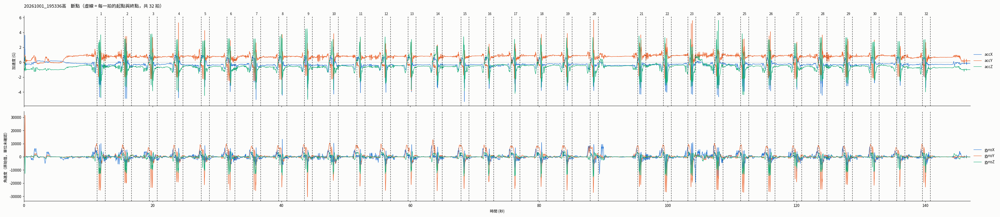
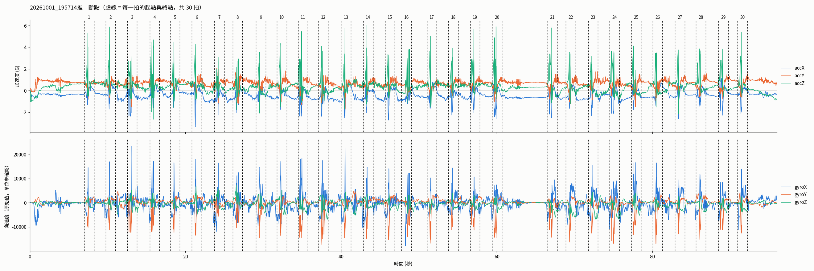
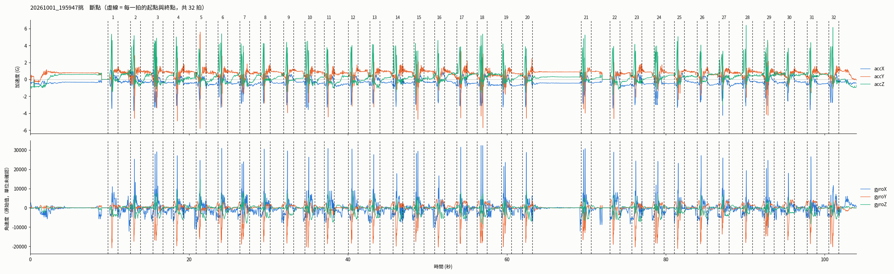

# dataset_2026（Garmin 手錶資料）

```
dataset_2026/
├── raw/                  手錶輸出的整段錄製 json（原封不動，不要改）
│   └── 2026_10_01/
│       └── garmin_20261001_195336高.json
├── cut/                  斷拍後一拍一個 csv
│   ├── strokes_index.csv     所有拍的索引表（一拍一列）
│   └── 2026_10_01/
│       └── 20261001_195336高/
│           └── 20261001_195336高_01.csv
├── plots/                斷拍結果檢查圖（每個錄製一張）
├── scripts/
│   ├── segment_strokes.py    斷拍
│   ├── garmin_io.py          讀檔 + 單位換算（給模型用）
│   └── visualize_garmin_json.py
└── pilot/                正式收案前的測試錄製（9/17、9/18、9/29），不進資料集
```

## 命名

- 日期資料夾 `2026_10_01`：跟 Drive、「2026受試紀錄」試算表的日期欄一致
- 錄製 `20261001_195336高`：跟試算表的「影片檔名」欄一致，可以直接對回影片與受試者
- 單拍 `20261001_195336高_01`：錄製 + 第幾拍（依時間順序）
- 球種看檔名最後的 高 / 推 / 挑，索引表的 `stroke_type` 欄也有

## 新資料進來時

1. 從 Drive 下載 json，放到 `raw/<日期>/`，檔名用試算表「檔案」欄的名字（`garmin_20261001_195336高.json`）
2. `python3 scripts/segment_strokes.py raw/<日期>/<檔名>.json`（不給參數就重跑 raw/ 底下全部）
3. 打開 `plots/<日期>/` 的圖確認拍數，多切的拍把 csv 刪掉並從 `strokes_index.csv` 移除該列

## 斷拍演算法

沿用實驗室先前的斷拍方法（門檻式峰值偵測，見學長姐的 `斷拍.ipynb`），並做了以下修改（列在本節後半）。
程式在 `scripts/segment_strokes.py`。

揮拍的瞬間手腕轉得最快，所以用「角速度夠大」來判定一拍。每個錄製檔各自獨立處理：

1. **算角速度合量**：每一筆取三軸合量 `mag = √(gyroX² + gyroY² + gyroZ²)`，
   不管手錶怎麼戴、往哪個方向轉，揮拍時這個值都會衝高。
2. **定門檻**：`門檻 = 0.7 × mag 的平均 + 0.3 × mag 的最大值`。
   門檻是每個檔自己算的，所以揮拍力道大的人門檻也會跟著高。
   10/1 三個檔的門檻約 11,000～13,000（原始值），揮拍峰值約 20,000～32,000，平常的動作在 10,000 以下。
3. **找峰值**：`mag` 超過門檻的局部最大值就算一拍，以這個峰值當作擊球瞬間。
   兩個峰值至少要隔 100 筆（1 秒）；1 秒內有好幾個超過門檻的峰，只留最高的那個，
   避免同一次揮拍被切成兩拍。
4. **切視窗**：每拍取峰值前 50 筆、後 75 筆，共 125 筆（1.25 秒）。這也是模型的輸入長度。
5. **略過不完整的拍**：峰值太靠近檔頭或檔尾、湊不滿 125 筆的不存檔（檢查圖上會標紅色 ×）。
6. **標記有問題的拍**（照樣存檔，只在索引表的 `flag` 欄註記）：
   - `gyro_dropout`：視窗內陀螺儀連續 10 筆以上三軸全為 0（手錶掉資料）
   - `gyro_saturated`：視窗內有任一軸的絕對值 ≥ 32000（接近 ±32764 的上限，峰值被截掉）

相對於先前方法的修改：

- 學長姐是「超過門檻後往後看 10 筆取最大」，可能停在上升途中；這裡取的是真正的局部最大值。
- 學長姐遇到湊不滿 125 筆的拍會存成比較短的 csv；這裡直接略過，確保每個 csv 都是 125 列。
- 多了 `flag` 標記和索引表。

已知的限制：

- 門檻跟檔案裡的最大值有關。如果錄製中有一下特別大的動作（例如甩手、撞到），門檻會被拉高，
  力道小的拍可能漏抓；反過來，揮空拍、撿球時的大動作也可能被當成一拍。所以每次斷完都要看檢查圖對拍數。
- 兩拍間隔小於 1 秒時只會留一拍。
- 只看陀螺儀。陀螺儀掉資料的那段如果剛好有揮拍，會整拍漏掉。

可調的參數都在 `segment_strokes.py` 和 `garmin_io.py` 開頭：`MIN_GAP_SAMPLES`（最小間隔）、
`PRE_SAMPLES` / `POST_SAMPLES`（視窗）、`GYRO_SATURATION`、`DROPOUT_RUN`；門檻公式在 `segment()` 裡。

### 斷拍結果範例（2026/10/01）

每張圖上半是三軸加速度、下半是三軸角速度（原始值），垂直虛線是每一拍的起點與終點，
兩條虛線中間上方的數字是拍號。圖由 `scripts/plot_cut_points.py` 產生。

**高（`20261001_195336高`，32 拍）**：錄製一開始（0 秒）的尖峰因為視窗不完整被略過。



**推（`20261001_195714推`，30 拍）**



**挑（`20261001_195947挑`，32 拍）**：9 秒與 72 秒附近角速度貼在 0 的平線是陀螺儀掉資料，
壓到第 1 拍與第 22 拍的前段（`flag` 標為 `gyro_dropout`）；第 18 拍接近飽和（`gyro_saturated`）。



## 單拍 csv 格式

有表頭、7 欄、125 列（峰值前 50 筆 + 後 75 筆，100 Hz），數值是 **Garmin 原始值**：

| 欄位 | 單位 |
|---|---|
| `time_ms` | 距離錄製開始的毫秒 |
| `accX/Y/Z` | milli-g |
| `gyroX/Y/Z` | 原始計數（±32764 飽和），1 原始值 ≈ 0.0365 度/秒（滿刻度約 ±1194 dps，2026-10-14 校正） |

## 給訓練好的模型讀

舊資料（`cut_data/挑cut`、`推cut`）是無表頭 8 欄、m/s² 與 rad/s。新資料不要直接丟進舊的
`load_imu_csv`，用 `scripts/garmin_io.py`，它會換成同樣的單位和 `(125, 6)` 形狀：

```python
import sys; sys.path.insert(0, "dataset_2026/scripts")
import numpy as np, pandas as pd
from garmin_io import load_stroke_for_model

index = pd.read_csv("dataset_2026/cut/strokes_index.csv", keep_default_na=False)
index = index[(index.stroke_type == "挑") & (index.flag == "")]
X = np.stack([load_stroke_for_model("dataset_2026/" + p) for p in index.csv_path])  # (N, 125, 6)
```

單位換算只寫在 `garmin_io.py` 一個地方，之後如果重新校正陀螺儀，只要改那裡的常數，不用重新斷拍。

## strokes_index.csv 欄位

`stroke_id, date, recording, stroke_type, stroke_no, csv_path, peak_idx, peak_time_ms, start_idx, end_idx, peak_gyro_mag, gap_prev_s, flag`

- `gap_prev_s`：跟上一拍峰值的間隔秒數，特別大或特別小的值得看一下圖
- `flag`：`gyro_dropout`（視窗內陀螺儀掉資料，連續全 0）、`gyro_saturated`（陀螺儀接近飽和），空白 = 正常
